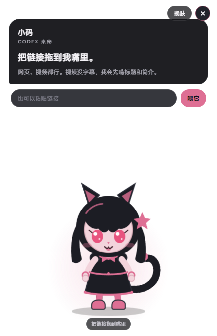
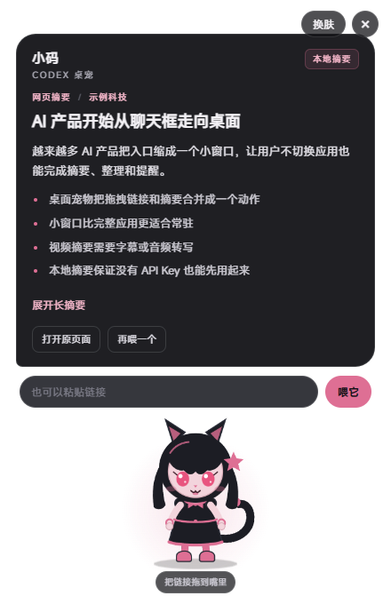

# 小码 · Codex 桌宠

一个透明置顶的小桌宠。把网页链接拖进嘴里，它会抓正文、做摘要。视频网站会先找字幕，拿不到就退回标题和简介。

把链接喂进去以后，结果会落在气泡里。

## 用之前

B 站视频的字幕要登录才能读。

- 点结果里的「扫码登录」，用手机 B 站扫一下
- 或者点「填 Cookie」，把浏览器里的 Cookie 整段贴进去

不登录也能用，只是 B 站视频只能看到标题、作者、时长和简介。

## 能做什么

- 把链接拖到嘴部，松手后开始读取
- 也可以把链接粘贴到底部输入框
- 网页输出一句结论、几条要点和可展开的长摘要
- YouTube 会尝试抓字幕，B 站读视频标题、作者、时长、标签和简介，不把推荐位当正文
- 视频有字幕时生成更长的分段摘要，没有字幕时显示视频信息并标明来源限制
- 三套皮肤，墨墨、云朵、电路兔，点右上角换肤
- 透明窗口，始终置顶，不占任务栏
- 拖动气泡顶部可以移动窗口
- 没有 AI Key 也能用，本机装了 Codex 就交给它分析，不会把字幕原样倒出来
- 配置 DeepSeek、OpenAI 或其他兼容接口后，优先走对应接口
- AI 调用失败会自动回退本地摘要，不会卡住

## 运行

需要 Node.js 18 以上。

    npm install
    npm start

如果 Electron 下载失败，可以换镜像重装。

    set "ELECTRON_MIRROR=https://npmmirror.com/mirrors/electron/"
    npm install
    npm start

跑测试。

    npm test

只检查一个链接的摘要结果。

    npm run smoke -- https://example.com

用真窗口模拟一次拖拽，检查拖拽、抓取和结果渲染。

    npm run smoke:ui

重新生成界面截图。

    npm run screenshot

## 配置 AI 摘要

不配置也能用。检测到本机 Codex 时，正文和字幕交给 Codex 做结构化摘要，每次大约十几秒。

没有 Codex 也没有 Key 时，退回本地抽取式摘要。这种方式只适合有标点的正文，语音识别字幕会比较粗糙。

复制 .env.example 为 .env，然后选一种配置。

DeepSeek。

    DEEPSEEK_API_KEY=你的key
    DEEPSEEK_MODEL=deepseek-chat

OpenAI 兼容接口。

    AI_API_KEY=你的key
    AI_BASE_URL=https://api.openai.com/v1
    AI_MODEL=gpt-4o-mini

OpenAI 官方接口。

    OPENAI_API_KEY=你的key
    OPENAI_MODEL=gpt-4o-mini

配置后，模型会读正文并输出结构化摘要。模型超时或报错时，界面会提示并改用本地摘要。

## B 站字幕

B 站的字幕接口要求登录。未登录时只能读到视频标题、作者、时长和简介。

结果卡片上有两个入口。

- 扫码登录，用手机 B 站扫一下，登录完成后 cookie 自动写进 .env
- 填 Cookie，把浏览器里的 Cookie 整段贴进来，保存后自动重读当前视频

    BILIBILI_COOKIE=你的cookie

Cookie 只在本机请求 B 站字幕接口时使用，.env 不会进 Git。过期后重新登录或重新贴一次。

## 视频支持

- YouTube 优先抓官方字幕接口，拿到后按全片顺序整理
- B 站读视频数据里的标题、作者、时长、标签和简介，避开推荐位和评论区
- Vimeo、抖音、TikTok 等站点先读页面标题、简介和可见正文
- 没有字幕的视频会显示视频信息，不会假装已经看完
- 不下载视频文件，不绕过登录、付费墙或地区限制
- 需要音频转写的视频，后续可以接本地 Whisper

## 数据边界

- 不配置 AI 且本机有 Codex 时，正文会交给本机 Codex 分析
- 没有 Codex 也没有 Key 时，链接只在本地 Electron 进程里抓取
- 配置 AI 后，正文和链接会发给你配置的模型服务
- 配置 BILIBILI_COOKIE 后，Cookie 只发给 B 站字幕接口，不会进入日志
- 没有账号体系，没有云端历史，关掉窗口就结束
- 不保存浏览记录，不做后台同步
- 摘要只根据能读到的内容生成，不补写页面里没有的信息

## 目录

    electron/
      main.cjs          透明置顶窗口、截图模式、IPC
      preload.cjs       暴露摘要和关闭接口
    src/
      extract.cjs       网页、元数据、YouTube 字幕提取
      local-summary.cjs 本地抽取式摘要
      ai-summary.cjs    可选的大模型摘要
      codex-summary.cjs 本机 Codex 摘要
      summarize.cjs     抓取、字幕、摘要的总流程
    renderer/
      index.html        桌宠、气泡、输入框和结果卡片
      styles.css        透明窗口、皮肤、动画和布局
      app.js            拖拽、换肤、结果渲染
    tests/
      summarize.test.cjs
    docs/
      pet.png           界面截图

## 当前边界

- 登录页、付费墙和强反爬页面可能读不到正文
- 没有后台常驻、托盘菜单和开机启动
- 没有鼠标穿透模式，窗口矩形区域会占住桌面空间
- 没有音频转写
- 没有打包好的 exe 安装包
- 摘要质量取决于正文完整度和模型能力

## 后续可以加

- 系统托盘和开机启动
- 鼠标穿透
- 本地 Whisper 音频转写
- 更多视频站的字幕适配
- 摘要历史和收藏
- 打包成 Windows 安装包
- 把摘要结果导出成 Markdown
